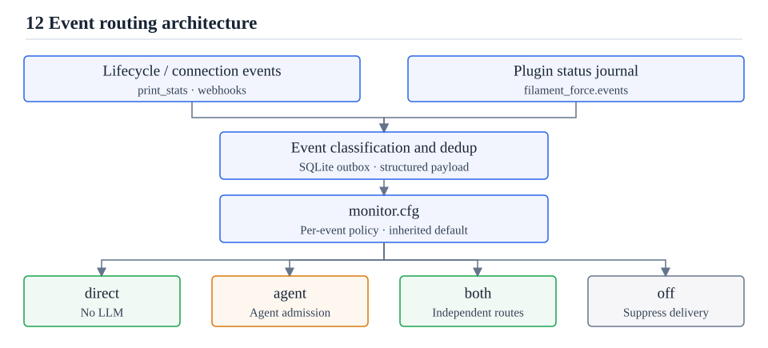

# Hermes Kalico Monitor

English | [简体中文](README.zh-CN.md)

An independent read-only Klipper/Kalico event monitor and Hermes plugin. Local printer protection remains in the firmware host; Monitor subscribes, deduplicates, persists and routes events.



## Features

- Moonraker lifecycle, connection, progress and stall monitoring.
- filament_force incident journal and legacy force compatibility.
- SQLite outbox, per-event direct/agent/both/off routes, signed webhooks.
- Interactive monitor.cfg configuration, user-service installation and read-only /kalico commands.

> Monitor is not a safety controller. Generic conditional rules, multi-printer aggregation, arbitrary direct-message field selection and remote motion control are not implemented. Live printer–Hermes–Feishu acceptance remains outstanding.

## Quick start

```sh
git clone https://github.com/wangyh775/hermes-plugin-kalico-monitor.git
cd hermes-plugin-kalico-monitor
bash install.sh
bash install.sh --check
```

Configure reachable Moonraker, Hermes Gateway, chat authorization and routes in the installer. Keep credentials private. Enable watch_nozzle_force only if you want optional force events. Verify actual chat delivery, not just HTTP success. See installation and configuration guides before applying.

`/kalico status` · `/kalico temp` · `/kalico alerts` · `/kalico health` · `/kalico help`

## Documentation

- [Installation](docs/INSTALL.md)
- [Configuration](docs/CONFIGURATION.md)
- [Architecture](docs/ARCHITECTURE.md)
- [Events](docs/EVENTS.md)
- [Event routing](docs/EVENT_ROUTING.md)
- [Integration](docs/INTEGRATION.md)
- [Commands](docs/COMMANDS.md)
- [Troubleshooting](docs/TROUBLESHOOTING.md)
- [Testing](docs/TESTING.md)

[Detailed deployment guide (Chinese)](docs/ONE_CLICK_INSTALL.zh-CN.md) · [filament_force](https://github.com/wangyh775/klipper-filament-force)

Documentation baseline: main 0c47b84. Source changes merged; no hardware-acceptance claim.
