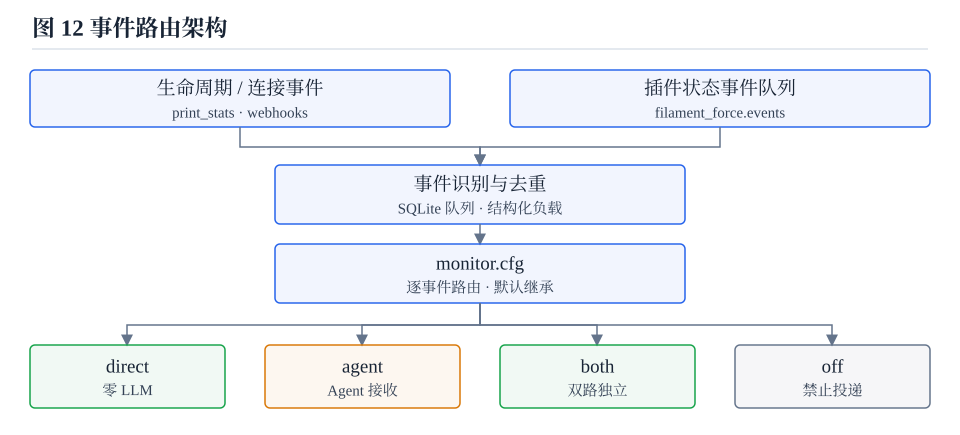

# Hermes Kalico Monitor

简体中文 | [English](README.md)

独立的 Klipper/Kalico 只读事件监控服务与 Hermes 插件。本地保护留在打印机主机，Monitor 负责订阅、去重、持久化与路由。



## 功能

- Moonraker 生命周期、连接、进度及停滞监控。
- filament_force 故障事件队列及旧受力模块兼容。
- SQLite Outbox、逐事件 direct/agent/both/off 路由、签名 Webhook。
- monitor.cfg 交互配置、用户服务安装及只读 /kalico 命令。

> Monitor 不是安全控制器。通用条件规则、多打印机聚合、任意直推字段定制与远程运动控制尚未实现。打印机—Hermes—飞书完整实机验收仍待完成。

## 快速安装

```sh
git clone https://github.com/wangyh775/hermes-plugin-kalico-monitor.git
cd hermes-plugin-kalico-monitor
bash install.sh
bash install.sh --check
```

通过安装器配置可达 Moonraker、Hermes Gateway、群权限及路由。保护密钥，需要受力事件时启用 watch_nozzle_force。必须验证真实群消息，而非仅 HTTP 成功。应用前阅读安装和配置手册。

`/kalico status` · `/kalico temp` · `/kalico alerts` · `/kalico health` · `/kalico help`

## 文档导航

- [安装与升级](docs/INSTALL.zh-CN.md)
- [配置参考](docs/CONFIGURATION.zh-CN.md)
- [系统架构](docs/ARCHITECTURE.zh-CN.md)
- [事件接口](docs/EVENTS.zh-CN.md)
- [事件路由](docs/EVENT_ROUTING.zh-CN.md)
- [系统集成](docs/INTEGRATION.zh-CN.md)
- [命令参考](docs/COMMANDS.zh-CN.md)
- [故障排查](docs/TROUBLESHOOTING.zh-CN.md)
- [测试与验收](docs/TESTING.zh-CN.md)

[详细一键部署指南](docs/ONE_CLICK_INSTALL.zh-CN.md) · [filament_force](https://github.com/wangyh775/klipper-filament-force)

文档基准 main 0c47b84。功能已合并，不代表实机验收完成。
