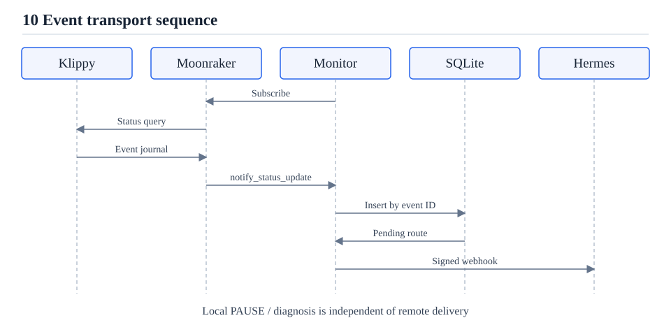

# Architecture

English | [简体中文](ARCHITECTURE.zh-CN.md) · [Home](../README.md)

> Reference: main commit 0c47b84 (PR #21 merged). Read-only monitor; live printer–Hermes–Feishu acceptance outstanding.

*Fig. 10. Remote event transport, independent of local motion.*

The printer host runs Kalico/Klipper and Moonraker. The AI host runs an independent systemd user service, Monitor, and a Hermes Gateway/plugin. They may be on separate reachable hosts. Monitor opens a WebSocket, merges status deltas into snapshots, derives lifecycle transitions, and reads the optional force journal. Native Klippy events are not Moonraker notifications. The SQLite outbox records alerts and route state; delivery worker sends signed webhook requests and retries separately. No G-code or motion control is issued. Hermes can provide independent authorized tools (e.g. Kiln), but they are outside Monitor's implementation and permission boundary.

| Module | Responsibility |
|---|---|
| monitor.py | WebSocket, connection state, dispatch worker |
| events.py / watch.py | Status delta merge and lifecycle classification |
| filament_events.py / force.py | New source journal and legacy force bridge |
| storage.py | SQLite dedup, payload, retry checkpoints |
| policy.py / monitor_cfg.py | Routes and config inheritance |
| notifier.py | Signed V2 webhook |
| quick.py / status.py | Read-only quick commands |
| setup.py / bootstrap.py | Interactive config, integration and setup |
