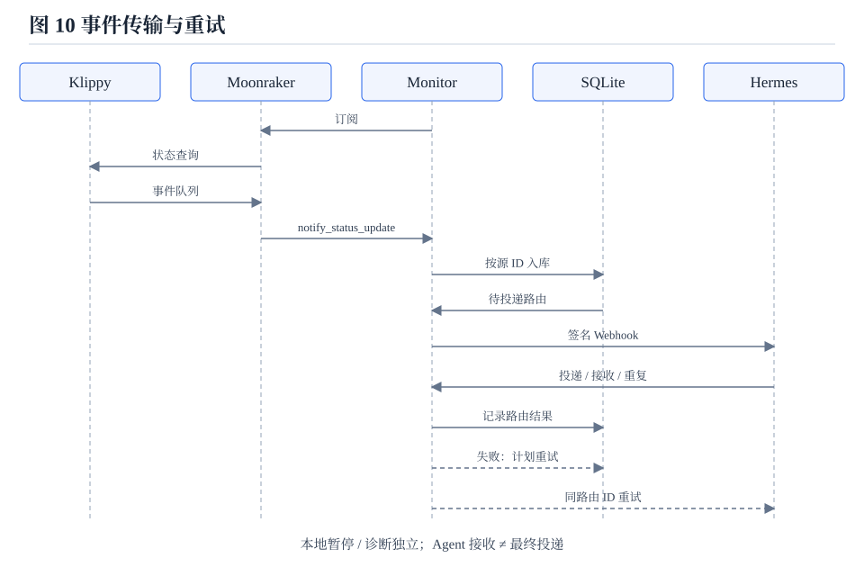

# 系统架构

简体中文 | [English](ARCHITECTURE.md) · [首页](../README.zh-CN.md)

> 依据 main 提交 0c47b84（PR #21 已合并）。Monitor 只读，打印机—Hermes—飞书实机验收尚未完成。

*图 10. 远程事件传输独立于本地运动。*

打印机主机运行 Kalico/Klipper 与 Moonraker；AI 主机运行独立 systemd 用户服务 Monitor 及 Hermes Gateway/插件。两者可分机，只需网络可达。Monitor 建立 WebSocket，合并状态增量、识别生命周期并读取可选受力队列。Klippy 原生事件并非 Moonraker 通知。SQLite Outbox 保存事件及路由状态；投递 worker 负责签名 Webhook 与独立重试。不发送 G-code 或运动指令。Hermes 可以通过独立授权工具（如 Kiln）处理事件，但不属于 Monitor 实现和权限边界。

| 模块 | 职责 |
|---|---|
| monitor.py | WebSocket、连接状态、投递 worker |
| events.py / watch.py | 状态合并与生命周期识别 |
| filament_events.py / force.py | 新事件队列与旧受力桥接 |
| storage.py | SQLite 去重、负载、重试检查点 |
| policy.py / monitor_cfg.py | 路由及配置继承 |
| notifier.py | V2 签名 Webhook |
| quick.py / status.py | 只读快捷命令 |
| setup.py / bootstrap.py | 交互配置、集成与安装 |
