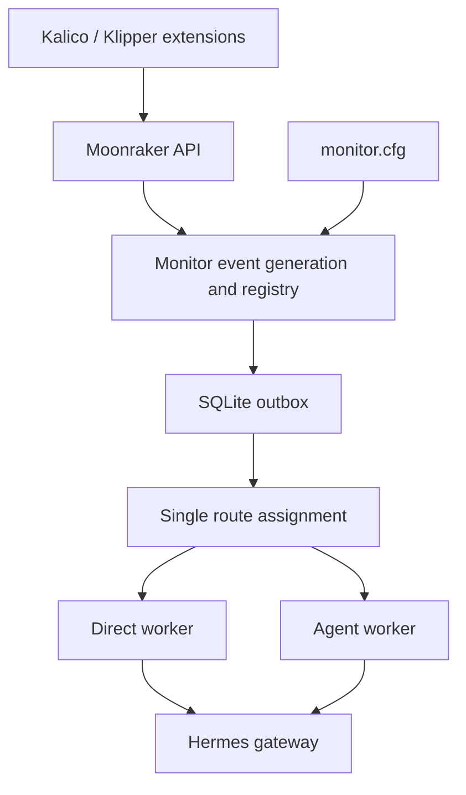

# Event reliability and architecture

Monitor is a standalone, read-only event producer/router. It never executes printer actions and has no Kiln dependency. The optional klipper-filament-force extension is a separate Klipper project; Monitor reads its event journal through Moonraker WebSocket/HTTP only. Its original payload, window samples and IDs remain unchanged.



## Operational behavior

* A single connection-state transition path handles loss and recovery; WebSocket heartbeat, RPC probes when silent, and subscription refresh retain distinct purposes. Expired connection epochs and subscription request IDs reject stale responses. Transport, RPC and subscription health remain distinguishable. Optional objects are rediscovered when degraded.
* Shutdown notifications are persisted before diagnosis. Ready state, recovery alert and incident closure share a transaction. Known incident keys preserve per-route ordering; legacy rows are migrated only where identity can be established. Critical events with malformed optional data retain their stable ID and minimal payload; invalid data and terminal failures enter dead_letters.
* One route assignment loop allocates independent Direct/Agent tasks. Each worker has one in-flight request, retries temporary failures, and prioritizes critical alerts. HTTP 400/413/422 and local serialization failures are terminal by current policy. Acknowledgement is not guaranteed final chat delivery or inference completion. Pending progress reports older than 30 minutes expire.
* Rules require valid, fresh observations; a fired condition rearms only on a valid normal reading. Job identity uses history when available and conservative fallback. Filament journal checkpoints are atomic; known sequence gaps are reported, repeated records skipped, and late missing records remain eligible.
* SQLite uses WAL and short transactions. Storage health is updated during maintenance; terminal informational G-code payloads older than seven days are compacted hourly (up to 1,000 per pass). IDs and pending/critical records are retained. No hard DB size cap or asynchronous writer.
* Native events are opt-in. Identical consecutive payloads within 2 seconds are deduplicated except button/G-code events; informational G-code notifications are limited to 10 seconds per route. The 16 KiB cap counts and drops oversized native payloads.

## Configuration and diagnostics

Existing monitor.env and monitor.cfg syntax is unchanged. Configuration extensions are parsed together. Direct templates are owned by the message configuration, not Agent routing. Handler/Skill behavior is frozen. The legacy watch_nozzle_force setting still enables filament_force events; obsolete Python subscription flags filament_only/legacy_only are removed. The deprecated nozzle_force_anomaly: off setting is accepted with a warning for upgrade compatibility.

```ini
[reliability]
subscription_refresh: 30
subscription_timeout: 20
observation_gap: 35
field_max_age: 120
connect_timeout: 5
```

See [event schema](event-envelope-v1.schema.json) and the configuration reference. Existing event IDs and schema fields remain compatible; unknown source wall time is nullable.

```bash
kalico-monitor config --check
kalico-monitor events
kalico-monitor dead-letters list
kalico-monitor incidents list
kalico-monitor storage status
python -m pytest -q
ruff check .
```

The tests exercise failure and rollback paths, not physical hardware. Verify actual Moonraker/Hermes/Feishu traffic and sustained storage behavior on the device. Monitor is not a printer safety system.

Historical implementation notes: [phase 1](archive/EVENT_RELIABILITY.md), [phase 2](archive/EVENT_RELIABILITY_PHASE2.md), [phase 3](archive/EVENT_RELIABILITY_PHASE3.md). Archived descriptions are historical, not current defaults.
