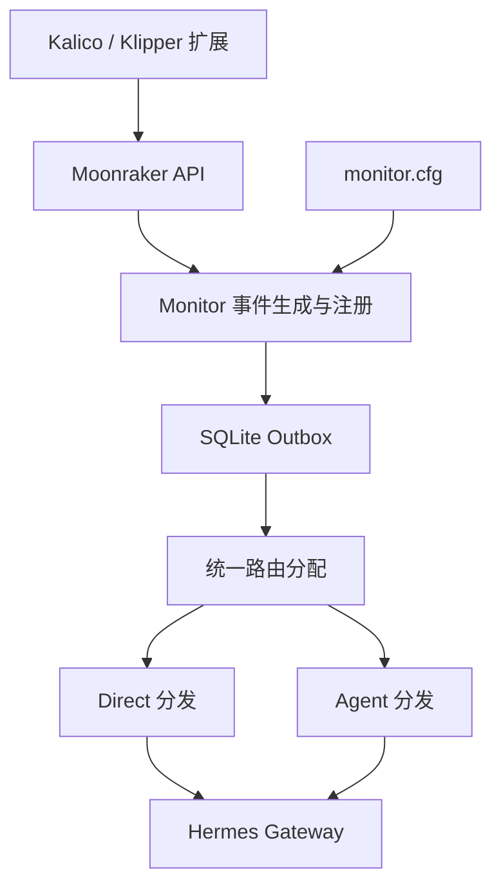

# 事件可靠性与系统架构

Monitor 是独立、只读的事件生成与路由服务，不执行打印机动作，不依赖 Kiln。klipper-filament-force 是独立的 Klipper 扩展；Monitor 仅通过 Moonraker WebSocket/HTTP 读取事件日志，原始载荷、受力窗口及事件 ID 保持不变。



## 运行机制

- 统一通信状态转换；WebSocket 心跳、静默时 RPC 探测、订阅刷新各司其职。连接代次和订阅请求 ID 拒绝迟到响应，传输、RPC、订阅状态保持区分；降级时重新发现可选对象。
- Shutdown 先入库后查询。Ready、恢复事件和 Incident 关闭同一事务提交；同一故障按路由保证顺序，历史关联仅在身份可确认时迁移。关键载荷损坏时保留原 ID 与最小合法告警，异常输入与永久失败进入死信表。
- 单一路由分配入口，Direct、Agent 独立投递与重试；每路一个在途请求，关键事件优先。HTTP 400/413/422 与本地编码失败按现有策略终结，其他临时错误重试。确认不等于飞书最终送达或模型推理结束。超过30分钟的待发进度报告过滤。
- 自定义规则需有效新鲜观测；有效正常值才重新武装。任务身份优先使用可用 History，辅以保守回退。插件事件与游标原子保存，跳过重复记录，报告已知序列缺口，迟到缺失记录仍可入库。
- SQLite WAL 与短事务；每分钟更新存储健康状态，每小时最多压缩1000条七天前已终结普通 G-code 载荷，保留 ID、关键事件和待发事件。没有硬容量限制或独立写线程。
- 原生通知默认关闭；连续相同内容2秒去重（按钮与 G-code 除外），普通 G-code 每路10秒通知限频，16 KiB 原生载荷上限。

## 配置与诊断

monitor.env、monitor.cfg 格式不变。配置扩展统一解析，Direct 模板与 Agent 路由解耦，Handler/Skill 冻结。现有 watch_nozzle_force 仍为 filament_force 事件开关；删除无效 Python 参数 filament_only/legacy_only。旧 nozzle_force_anomaly: off 仍提供迁移提示。

```ini
[reliability]
subscription_refresh: 30
subscription_timeout: 20
observation_gap: 35
field_max_age: 120
connect_timeout: 5
```

参见[事件规范](event-envelope-v1.schema.json)及配置参考。保留既有事件 ID 与字段，未知源绝对时间为空，不进行推算。

```bash
kalico-monitor config --check
kalico-monitor events
kalico-monitor dead-letters list
kalico-monitor incidents list
kalico-monitor storage status
python -m pytest -q
ruff check .
```

模拟故障及事务测试不能替代实机验收；仍需在设备验证真实通信、飞书通知与长期数据库增长。Monitor 不是打印机实时安全保护系统。

历史开发记录：[第一轮](archive/EVENT_RELIABILITY.zh-CN.md)、[第二轮](archive/EVENT_RELIABILITY_PHASE2.zh-CN.md)、[第三轮](archive/EVENT_RELIABILITY_PHASE3.zh-CN.md)。归档仅记录当时实现，不代表当前默认参数。
