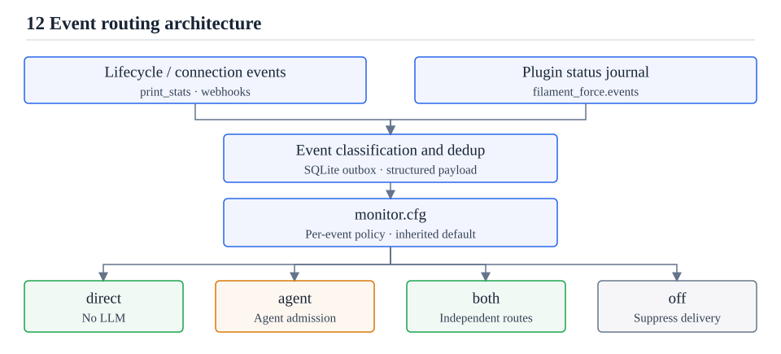

# Event routing

English | [简体中文](EVENT_ROUTING.zh-CN.md) · [Home](../README.md)

> Reference: main commit 0c47b84 (PR #21 merged). Read-only monitor; live printer–Hermes–Feishu acceptance outstanding.



*Fig. 12. Route selection is deterministic; no model chooses the route.*

## Policy

`direct`: configured deliver-only webhook, no LLM. `agent`: model-capable endpoint, acceptance does not mean final delivery. `both`: independently tracked routes, retries and request IDs. `off`: suppress delivery, not local detection. Default direct; explicit entries override. Routes disallowed by current policy are suppressed on dispatch; delivered history remains.

Inbound Hermes authorization and optional KALICO_ALLOWED_CHAT_IDS are distinct from outbound direct/agent chat IDs. An agent is not a safety controller. Do not grant printer-control tools by default. A custom event name in the policy editor merely configures routing; it does not create a detector or rule engine.

```ini
[events]
default: direct
filament_jam_detected: direct
filament_jam_confirmed: both
filament_recovery_failed: both
nozzle_force_anomaly: off
```

Example policy only; configure a valid agent endpoint and chat before enabling both. The existing legacy event remains supported. Per-event arbitrary direct-message field selection is not implemented.
