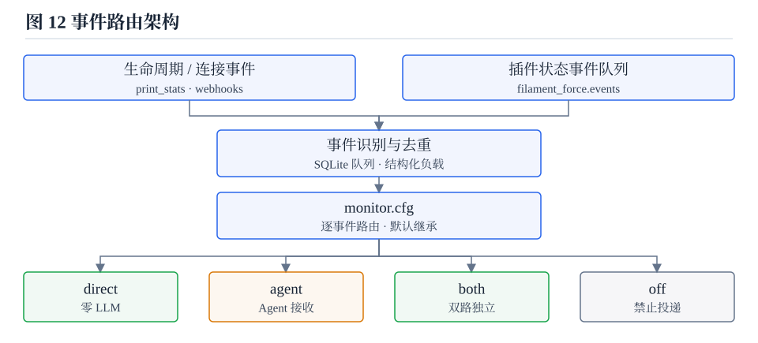

# 事件路由

简体中文 | [English](EVENT_ROUTING.md) · [首页](../README.zh-CN.md)

> 依据 main 提交 0c47b84（PR #21 已合并）。Monitor 只读，打印机—Hermes—飞书实机验收尚未完成。



*图 12. 确定性路由，不由模型选择。*

## 策略

`direct`：deliver-only Webhook，不调用模型。`agent`：模型入口，accepted 不代表最终投递。`both`：两路独立状态、重试及请求 ID。`off`：禁止推送，不关闭本地检测。默认 direct，显式项覆盖；当前策略不允许的历史待投递路由被抑制，已投递历史保留。

Hermes 入站授权与可选 KALICO_ALLOWED_CHAT_IDS 独立于出站 direct/agent 群 ID。Agent 不是安全控制器，不应默认授权控制工具。事件编辑器自定义名称仅配置路由，不创建检测规则。

```ini
[events]
default: direct
filament_jam_detected: direct
filament_jam_confirmed: both
filament_recovery_failed: both
nozzle_force_anomaly: off
```

仅为路由示例；启用 both 前配置 Agent 地址与目标群。旧事件仍兼容。逐事件任意直推字段定制尚未实现。


## 受力事件路由示例

```ini
[events]
default: direct
nozzle_force_anomaly: off
filament_jam_detected: direct
filament_runout_detected: direct
filament_diagnosis_result: direct
filament_jam_confirmed: both
filament_z_adjusted: direct
filament_recovery_started: direct
filament_recovery_verified: direct
filament_recovery_failed: both
```

仅为示例；先配置并验证两个 Webhook。paused/resumed 是独立生命周期事件。off 禁止路由，不关闭生产方。旧版支持为兼容保留；任意直推字段定制与自定义检测规则尚未实现。
